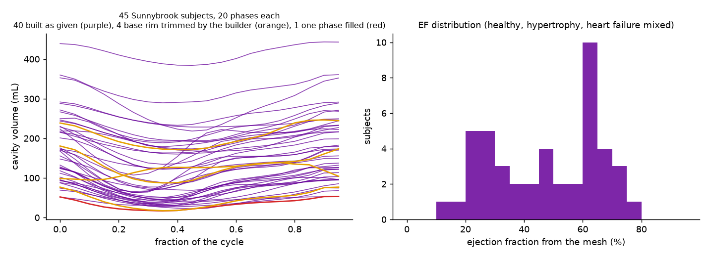
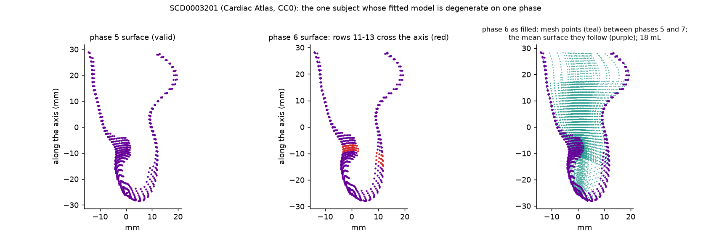

# Getting the demo data

hexmb is demonstrated on **public-domain** left-ventricle geometry so anyone can
reproduce the pipeline. No private patient data is shipped in this repository.

## Cardiac Atlas Project — Sunnybrook Cardiac Data (SCD)

- **What it is:** 45 cardiac-MRI studies across mixed pathologies (healthy,
  hypertrophy, heart failure with and without infarction), each with expert
  short-axis contours and a **3D left-ventricle finite-element model** per
  cardiac phase (~20 phases per subject). Also known as the 2009 Cardiac-MR LV
  Segmentation Challenge data.
- **Licence:** Public Domain (**CC0 1.0 Universal**) — free to use for any
  purpose, no request or authorisation needed.
- **Download:** https://www.cardiacatlas.org/sunnybrook-cardiac-data/
  (project home: https://www.cardiacatlas.org/). The LV finite-element models are
  provided alongside the images; the CAP Client on the site imports them.

### File format

Each phase is a pair of CMISS/`cmgui` export files:

| file | holds |
|---|---|
| `*.model.exnode` | node values: prolate-spheroidal `lambda` with its three Hermite derivatives, `mu`, `theta`, and one `focus` per model |
| `GlobalHermiteParam.exelem` | element topology and scale factors (bicubic Hermite `lambda` circumferential x longitudinal, linear transmural; trilinear `mu` and `theta`) |

hexmb evaluates that definition as written (`hexmb.io.cap`): bicubic Hermite
`lambda` per element with the file's scale factors, sampled on the model's own
longitudinal parameter and uniform `theta`, so the 40 nodes are reproduced
exactly and every ring of the surface winds once about the model axis.  The
`.exelem` is one template for every Sunnybrook subject (only the focus differs,
and the `.exnode` carries that too), so a copy ships in the package and is used
when none sits beside the `.exnode`.  Versions up to 0.2.0 interpolated the node
positions in Cartesian space instead, which bent the first rings at the apex
into crescents and under-read the cavity by 3-30 % (median 8 %, most at
end-systole).  The reader warns when a model crosses its own long axis
(`lambda <= 0` somewhere), naming the rows to drop with `apex_trim` / `base_cut`.

## Bundled subject

One subject (SCD0000101, all 20 phases, 170 KB) ships inside the package under
`hexmb/data/cap/`, so `hexmb demo -o out` and the quick-start notebook run with no
download. Download the full set (45 subjects) from the link above for a cohort.

## Run the demo

```bash
# one LV model -> endocardial surface -> STL/CAD -> telescoping hex mesh + quality gate
python scripts/cap_to_mesh.py /path/to/SCD0000101_1.model.exnode -o out/lv --stl out/lv_endo.stl
```
```text
[1] read CAP model: .../SCD0000101_1.model.exnode
    endocardial surface (40, 56, 3)  mid-radius ~28 mm
[2] wrote CAD surface: out/lv_endo.stl  (4368 triangles, mm)
[3] mesh with hexmb (telescoping: coarse apex / fine body / coarse base)
    zone apex :    12617 cells  min scaled-Jac +0.391  (valid)
    zone body :    26796 cells  min scaled-Jac +0.612  (valid)
    zone base :    31900 cells  min scaled-Jac +0.616  (valid)
[4] wrote telescoping polyMesh under out/lv  (AMI-coupled)
```

`hexmb cap --exnode /path/to/SCD0000101_1.model.exnode -o out/lv --stl out/lv_endo.stl`
does the same thing from the CLI.

What it creates:

- **`out/lv_endo.stl`** — the endocardial blood-pool surface as a CAD file (mm).
- **`out/lv/`** — the telescoping case: zone meshes `apex/`, `body/`, `base/`, with
  `out/lv/apex/` the merged master carrying the AMI couplings (open `out/lv/apex` in
  ParaView). Patches are `wall` / `inlet` (mitral) / `outlet1` (aortic).

`checkMesh -constant` on the assembled mesh reports **Cell volumes OK** (zero
negative-volume cells); a face or two may sit just over the skewness flag at the
curved zone transition, which the FV skewness-corrected schemes tolerate.

## The whole Sunnybrook cohort through hexmb 0.2 (8 November 2026)

All 45 subjects of the Cardiac Atlas Sunnybrook models (CC0; 20 phases each,
one subject has 18) were run through `build_lv_motion` with the default
conformal template (14 688 cells per phase, apex trim 2 %), the signed-pyramid
gate, the builder's own ring screen and rim trimming, and the per-phase
checkMesh-style metrics on (`metrics=True`), two subjects at a time on a
laptop, 50-99 s per subject (median 55 s).  The script is a 40-line loop over
the `.exnode` files; nothing was set per subject.

<p align="center"></p>

| | subjects |
|---|---|
| valid on every phase, built exactly as given | **40 of 45** |
| valid after the builder trimmed the base rim by itself (`base_cut` 0.98, 0.95, 0.97, 0.92) | 4 |
| valid after the builder filled one degenerate phase from its neighbours | 1 (SCD0003201) |
| valid moving-mesh cases | **45 of 45** |

Cavity volumes from the meshes: EDV 53-443 mL (median 171), ESV 17-384 mL
(median 77), EF 13-77 % (median 49), which is the mixed healthy / hypertrophy /
heart-failure make-up of the Sunnybrook set.

**Mesh quality over the cohort (OpenFOAM's definitions, computed by hexmb,
worst phase per subject; the last two columns of the table).**  Max skewness
is 2.3-3.1 (median 2.60): no face of any phase of any subject reaches
OpenFOAM's warning level of 4.  Max non-orthogonality is 55-80 deg (median
65 deg); 8 of 45 subjects have faces above 70 deg on some phase (SCD0001801,
SCD0001901, SCD0002001, SCD0002501, SCD0002701, SCD0003001, SCD0003201,
SCD0003401), the two above 75 deg being the two smallest hearts (SCD0003201
76.9 deg, SCD0003401 79.6 deg).  Those faces are few (10 of 45 432 on
SCD0003401's worst phase) and sit inside the butterfly core, 4-6 mm from the
long axis, in the lower half of the ventricle: the ring centres of a small,
curved ventricle shift sideways from one level to the next, so the core's
axial faces are sheared.  A finite-volume solve handles them with the limited
corrected Laplacian and non-orthogonality correctors that `hexmb flow` writes
(the moving-ventricle runs behind this template used the same); a core that
follows the local centreline tilt, or an elliptic smoother, would remove them
and is on the roadmap.

**What the trims cost** (column `trim removed`, the cavity volume above the
cut on each phase): SCD0000301 2.5-4.1 mL (1.5-1.6 % of the cavity),
SCD0000601 3.8-10.4 mL (4.3-5.4 %), SCD0001901 3.0-5.2 mL (2.8-3.7 %) and
SCD0003301 2.7-6.8 mL (7.7 % at end-diastole, 13.8 % of the 17 mL end-systolic
cavity).  The EDV / ESV / EF in the table are those of the trimmed cavity; a
reader comparing them with a clinical value should add the removed volume
back.

**What the builder had to do, and why.**  Before building, every ring of every
phase is screened: the polar angle of its points about the ring centre must
advance one way and total one turn.  A ring that passes through the long axis
fails that screen; for a Cardiac Atlas model that is where `lambda` reaches
zero, and the reader warns about the same rows.  Four subjects have such rings
on one to three end-systolic phases.  In three of them the bad rows are the top
one to three of 40, the base rim, and the builder moved `base_cut` down to the
last good row for every phase: SCD0000301 (row 39 on phases 7-9; cut 0.98),
SCD0000601 (rows 38-39 on phases 6-7; cut 0.95) and SCD0003301 (rows 37-39 on
phases 5-7; cut 0.92).  SCD0001901 has no bad ring: its base narrows inward
over the last three rows through the middle of the cycle (mean ring radius
20.9, 19.8, 18.2 mm on phase 6) and 16 cells at the top of the base zone fail
the pyramid test on seven phases; the builder lowered `base_cut` by one step to
0.97, rebuilt every phase, and all pass (93 s instead of 45).  SCD0003201
crosses the axis at rows 11-13 of 40, a third of the way up from the apex, on
phase 6 at a cavity of 17 mL.  A surface that passes through itself there has
no valid mesh and no trim reaches it, so the builder marked the phase failed
and replaced it by the linear interpolation in time between phases 5 and 7
(17.8 mL; every cell passes the gate).  The quality table says `filled` for
that phase and names the neighbours.

<p align="center"></p>

*SCD0003201, long-axis cut.  Left: phase 5, valid.  Middle: phase 6, where
rows 11-13 (red) pass through the long axis.  Right: the mesh points the
builder writes for phase 6 (teal) and the mean of phases 5 and 7 they follow
(purple).*

The honest statement is that the default template meshes 40 of 45 unselected
clinical subjects exactly as given, the builder's own trimming takes that to
44 with a cut of 2-8 % of the long axis, and the one degenerate phase in the
cohort is filled from its neighbours and reported.  Before the ring screen and
the rim retry existed (earlier on 6 November) the same cohort gave 41 at the
defaults and 44 with a hand-set `base_cut`; SCD0000301 moved from "passes at
the defaults" to "trimmed" because its top row crosses the axis on three
phases and the screen now removes that row even though the cells happened to
pass (EDV 250 -> 247 mL).

Earlier still, before the exact Atlas reader and the axial re-spacing of the
levels, the numbers were 36 of 45 at the defaults and 40 with one setting, and
the failures looked like a mesher problem at a sharply curved apex.  The cause
was the reader: the five subjects that failed in the apex zone (SCD0001801,
SCD0002901, SCD0003401, SCD0003501, SCD0003801) pass at the defaults once the
Atlas model is evaluated as defined, and every end-diastolic volume is
3-13 % larger because the old reader bent the first rings inward.

| subject | phases | valid | what the builder did | trim removed (mL, min-max over phases) | EDV mL | ESV mL | EF % | max skewness | max non-orth. (deg) |
|---|---|---|---|---|---|---|---|---|---|
| SCD0000101 | 20 | yes |  |  | 173.1 | 123.1 | 28.9 | 2.46 | 58.0 |
| SCD0000201 | 20 | yes |  |  | 249.2 | 188.5 | 24.4 | 2.65 | 69.1 |
| SCD0000301 | 20 | yes | `base_cut 1.000 to 0.980` (rings cross the axis) | 2.5-4.1 | 246.4 | 171.2 | 30.5 | 2.64 | 61.2 |
| SCD0000401 | 20 | yes |  |  | 228.5 | 134.4 | 41.2 | 2.48 | 61.2 |
| SCD0000501 | 20 | yes |  |  | 223.9 | 163.1 | 27.2 | 2.54 | 59.1 |
| SCD0000601 | 20 | yes | `base_cut 1.000 to 0.951` (rings cross the axis) | 3.8-10.4 | 180.5 | 87.4 | 51.5 | 2.96 | 66.8 |
| SCD0000701 | 20 | yes |  |  | 247.3 | 173.3 | 29.9 | 2.59 | 62.3 |
| SCD0000801 | 20 | yes |  |  | 443.1 | 384.0 | 13.3 | 2.50 | 65.3 |
| SCD0000901 | 20 | yes |  |  | 360.5 | 289.5 | 19.7 | 2.58 | 63.6 |
| SCD0001001 | 20 | yes |  |  | 269.9 | 194.0 | 28.1 | 2.35 | 66.8 |
| SCD0001101 | 20 | yes |  |  | 170.0 | 86.0 | 49.4 | 2.72 | 55.8 |
| SCD0001201 | 20 | yes |  |  | 126.6 | 68.7 | 45.7 | 2.50 | 66.8 |
| SCD0001301 | 20 | yes |  |  | 250.8 | 191.9 | 23.5 | 2.47 | 65.6 |
| SCD0001401 | 20 | yes |  |  | 271.4 | 178.7 | 34.2 | 2.51 | 63.6 |
| SCD0001501 | 20 | yes |  |  | 218.6 | 167.3 | 23.5 | 2.48 | 65.4 |
| SCD0001601 | 20 | yes |  |  | 291.5 | 232.7 | 20.2 | 2.49 | 55.3 |
| SCD0001701 | 20 | yes |  |  | 352.6 | 218.2 | 38.1 | 2.60 | 63.3 |
| SCD0001801 | 20 | yes |  |  | 216.1 | 160.1 | 25.9 | 2.58 | 70.5 |
| SCD0001901 | 20 | yes | `base_cut 1.000 to 0.970` (cells failed at the rim) | 3.0-5.2 | 138.8 | 94.7 | 31.8 | 2.73 | 73.6 |
| SCD0002001 | 20 | yes |  |  | 148.7 | 77.1 | 48.2 | 2.82 | 70.7 |
| SCD0002101 | 20 | yes |  |  | 232.2 | 123.3 | 46.9 | 2.67 | 65.9 |
| SCD0002201 | 20 | yes |  |  | 182.7 | 71.2 | 61.0 | 2.81 | 69.9 |
| SCD0002301 | 20 | yes |  |  | 200.9 | 121.8 | 39.4 | 2.43 | 58.1 |
| SCD0002401 | 20 | yes |  |  | 289.0 | 228.3 | 21.0 | 2.49 | 57.5 |
| SCD0002501 | 20 | yes |  |  | 96.6 | 28.5 | 70.5 | 2.66 | 74.7 |
| SCD0002601 | 20 | yes |  |  | 121.9 | 44.3 | 63.7 | 2.64 | 58.0 |
| SCD0002701 | 20 | yes |  |  | 94.6 | 41.2 | 56.5 | 2.71 | 70.9 |
| SCD0002801 | 20 | yes |  |  | 125.9 | 45.3 | 64.0 | 2.94 | 65.2 |
| SCD0002901 | 20 | yes |  |  | 171.1 | 65.7 | 61.6 | 3.04 | 57.6 |
| SCD0003001 | 20 | yes |  |  | 137.4 | 39.2 | 71.5 | 2.55 | 71.7 |
| SCD0003101 | 20 | yes |  |  | 233.0 | 107.1 | 54.0 | 2.65 | 66.9 |
| SCD0003201 | 20 | yes | phase 6 filled from its neighbours |  | 53.1 | 16.6 | 68.7 | 2.74 | 76.9 |
| SCD0003301 | 20 | yes | `base_cut 1.000 to 0.918` (rings cross the axis) | 2.7-6.8 | 76.7 | 17.3 | 77.5 | 3.00 | 60.1 |
| SCD0003401 | 18 | yes |  |  | 95.7 | 29.5 | 69.2 | 2.77 | 79.6 |
| SCD0003501 | 20 | yes |  |  | 101.1 | 34.9 | 65.5 | 2.92 | 64.2 |
| SCD0003601 | 20 | yes |  |  | 52.9 | 31.2 | 41.1 | 2.41 | 60.8 |
| SCD0003701 | 20 | yes |  |  | 113.4 | 41.1 | 63.7 | 3.06 | 66.3 |
| SCD0003801 | 20 | yes |  |  | 124.0 | 49.4 | 60.1 | 2.47 | 67.8 |
| SCD0003901 | 20 | yes |  |  | 75.0 | 22.3 | 70.2 | 2.54 | 63.9 |
| SCD0004001 | 20 | yes |  |  | 88.0 | 31.1 | 64.6 | 2.53 | 66.8 |
| SCD0004101 | 20 | yes |  |  | 155.6 | 62.6 | 59.8 | 2.64 | 58.1 |
| SCD0004201 | 20 | yes |  |  | 179.0 | 62.7 | 64.9 | 2.56 | 66.3 |
| SCD0004301 | 20 | yes |  |  | 103.4 | 36.7 | 64.5 | 2.67 | 56.2 |
| SCD0004401 | 20 | yes |  |  | 132.2 | 50.6 | 61.7 | 2.48 | 63.8 |
| SCD0004501 | 20 | yes |  |  | 69.1 | 27.2 | 60.7 | 2.60 | 65.2 |

## Synthetic masks of the bundled heart

The exact surface of SCD0000101 voxelised as a 10 mm and an 8 mm short-axis
stack (1.4 mm pixels) and as a 1 mm isotropic mask, read back by the two mask
readers and meshed, gives the reader-plus-mesher volume error against the known
answer; the table and figure are in
[docs/VERIFICATION.md](docs/VERIFICATION.md#input-verification-the-mask-readers)
(`scripts/synthetic_masks.py`).  The masks are derived from CC0 data and can be
regenerated in a minute, so they are not stored here.

## A note on the private data

An earlier version of this engine was developed against a cine-MRI case that is
**not public**, so it has been removed from this repository. The method is the
same; only the demonstration geometry changed to the CC0 CAP data above.
