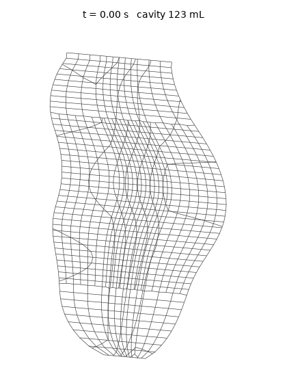
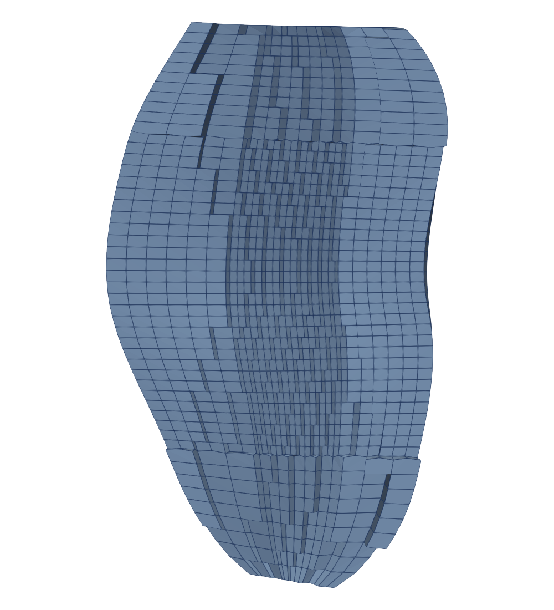
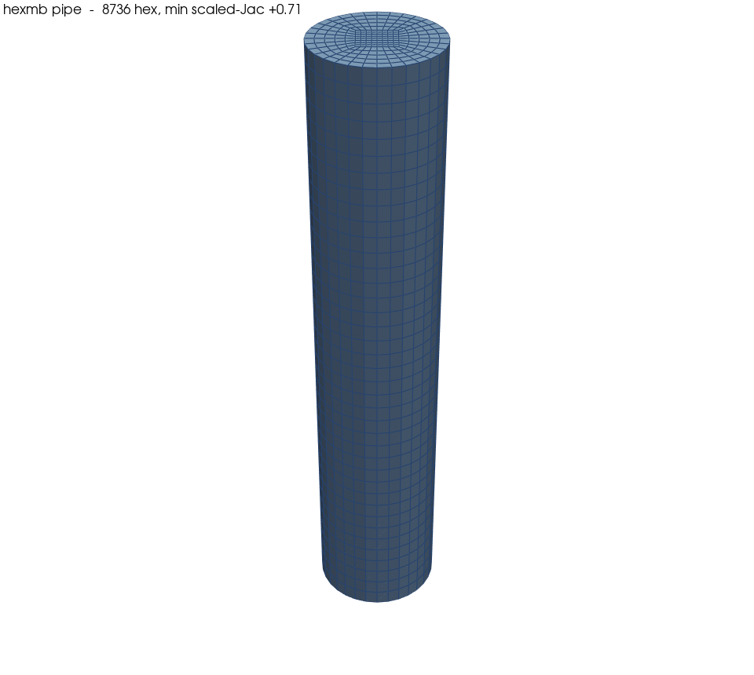
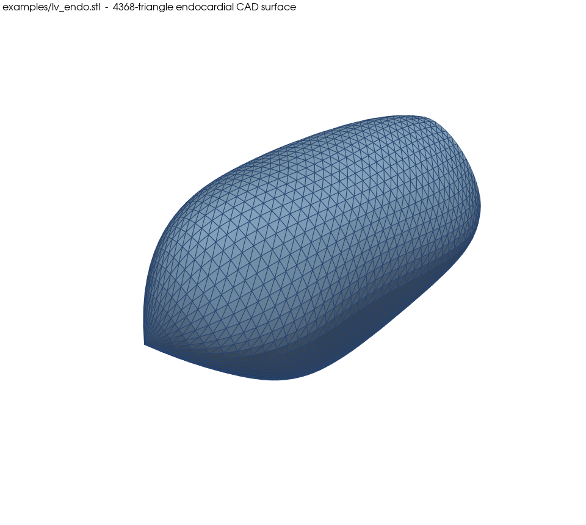
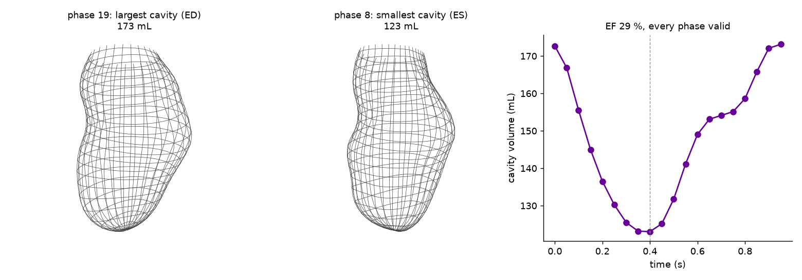
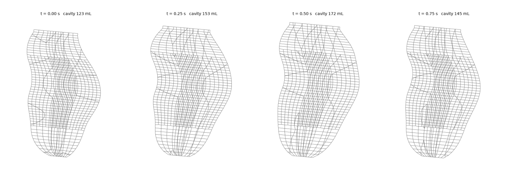
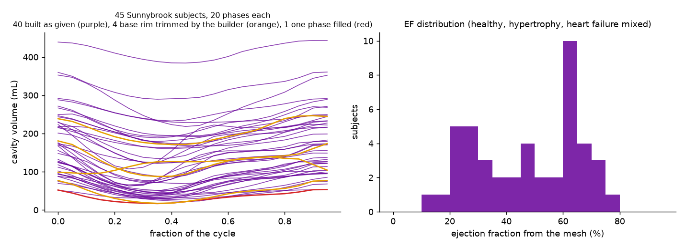

# hexmb — structured O-grid hex mesher for tubes and beating heart chambers

`hexmb` builds all-hexahedral **O-grid (butterfly)** meshes for CFD and writes
them directly as an OpenFOAM `constant/polyMesh`. An O-grid is a square "H" core
block surrounded by boundary-fitted petal blocks — all-hex, boundary-conforming,
and with **no singular polar axis**, so it can be rebuilt as one iso-topological
mesh through large deformation (a beating heart chamber) without remeshing.

**hexmb is the mesher: you give it a surface, it gives you the hex mesh.** The
surface can be a tubular STL, a closed or open left-ventricle surface in any
common mesh format, a segmentation mask, a Cardiac Atlas model, or an ordered
ring grid `(stations, angle, 3)` — from any segmentation, whoever produced it.
For a moving chamber you give one surface per phase and get back the moving-mesh
case.

One subject of the **public-domain** Cardiac Atlas Project (Sunnybrook Cardiac
Data, CC0) ships inside the package, so the whole left-ventricle pipeline runs
with no private data and no download: `hexmb demo`. See [`DATA.md`](DATA.md).

## What it produces

<p align="center">
  
  
</p>
<p align="center">
  
  
</p>

<p align="center"><em>Left to right, top to bottom: the conformal LV mesh of the bundled heart morphing through
its 20 cardiac phases (one iso-topological mesh, no remeshing); the same mesh cut along the long axis at
end-diastole (coarse apex cap, 2x-finer body, coarse valve cap, butterfly core, 2:1 split-hex transitions
at the two zone boundaries); a pipe O-grid (note the butterfly core cap, no polar axis); and the
endocardial CAD surface the mesh is built from. All in <a href="examples/">examples/</a>.</em></p>

<p align="center">
  
</p>
<p align="center"><em>What <code>hexmb demo --render</code> writes: the bundled heart's surface at its largest and
smallest cavity and the volume curve over the 20 phases, every phase passing the quality gate.</em></p>

## What it does, and where each part stands

| Track | What it does | Status |
|---|---|---|
| **Engine** — swept tubes + single chamber | O-grid meshes for a pipe, bend, tapered/STL vessel, or a heart chamber; near-wall boundary layers; whole-cycle rebuild by transfinite-interpolation resurfacing | **Verified.** `checkMesh`-clean; the LV rebuilds across the cardiac cycle with 0 inverted cells; assembly vectorised to millions of cells. |
| **Conformal telescoping LV** — multi-resolution, one region | Coarse apex cap + 2x-finer body + coarse valve cap joined by conformal split-hex 2:1 transitions: ONE flux-conservative region, no interpolated coupling | **Verified.** `checkMesh` Mesh OK at end-diastole and end-systole on the bundled heart; three-level refinement with grid-convergence indices in [docs/VERIFICATION.md](docs/VERIFICATION.md); in production use as the mesh behind the author's moving-ventricle CFD runs. |
| **Bring your own surface** | STL/OBJ/PLY/OFF, VTK/VTP/VTU, NIfTI mask (thick-slice stack or isotropic), Cardiac Atlas model, saved grid -> the ring grid, with automatic apex/base landmarks | **Working.** The STL route reproduces the model route's cavity volume on the bundled heart to 0.1 %; synthetic masks at scanner resolution come back within 1-3 % of the exact surface ([docs/VERIFICATION.md](docs/VERIFICATION.md)); please report what your own surfaces do. |
| **Moving mesh** | Per-phase surfaces -> the same mesh rebuilt at every phase, gated, written as an OpenFOAM 12 `interpolator` case | **Working.** The bundled heart runs through `foamRun -solver movingMesh` with positive volumes at every written time. |
| **Quality metrics, export, flow case** | checkMesh-style non-orthogonality / skewness / aspect ratio computed without OpenFOAM; VTK (`.vtu` per phase + `.pvd`) and Abaqus `.inp` export; a wall-driven `incompressibleFluid` flow case on the moving mesh | **Working.** Metrics match `checkMesh` to the printed precision; the flow case runs on the bundled heart at three mesh levels ([docs/VERIFICATION.md](docs/VERIFICATION.md)). |
| **Telescoping LV (AMI)** — multi-resolution, coupled zones | Coarse apex / fine body / coarse base as three zones joined by non-conformal AMI couplings, body to ~1M cells | **Working** for static meshes; the interpolated coupling is not flux-conservative and stalls a moving filling solve — use the conformal template for moving CFD. |

Branches, junctions, and multi-branch trees are **out of scope** — conforming
meshing through a junction is unsolved here.

## Install

Use a virtual environment (modern Linux blocks `pip` into the system Python):

```bash
python3 -m venv .venv && source .venv/bin/activate
pip install "hexmb[all] @ git+https://github.com/JieWangnk/hexmb"   # everything: surfaces, masks, figures
```

Or from a clone: `pip install -e ".[all,dev]"`, or with uv in a fresh venv:
`uv venv .venv && uv pip install -e ".[all,dev]"` (2 s with a warm cache). The core (numpy + scipy) builds
every mesh; the extras add `trimesh`/`rtree`/`meshio` (surface files),
`nibabel`/`scikit-image` (masks) and `matplotlib` (figures). OpenFOAM 12 is only
needed to run `checkMesh`, move the mesh, or run a solver on the output.

No install at all: open
[`examples/hexmb_quickstart.ipynb`](examples/hexmb_quickstart.ipynb) in Colab.

## Quick start

Every command prints a quality line and says what it wrote. The outputs below are
the real results of running each command.

**1. The bundled heart, all 20 phases — no data, no OpenFOAM, about a minute.**

(A longer walkthrough with every output, the per-phase STL route, the cut-plane
animation and the OpenFOAM moving-mesh run is in [docs/DEMO.md](docs/DEMO.md).)

```bash
hexmb demo -o out_demo --render
```
```text
demo: Cardiac Atlas SCD0000101, 20 phases (CC0), template conformal
  wrote out_demo/lv_endo_phase1.stl (4368 triangles, mm)
  template conformal: 14688 cells per phase, inlet rule 'sectors'
  phase  0  volume  172.7 mL  min cell vol +1.671e+00 mm3  failing cells 0
  ...
  phase 19  volume  173.1 mL  min cell vol +1.645e+00 mm3  failing cells 0
  reference phase 8 (t 0.4000 s, 123.1 mL); EDV 173.1  ESV 123.1 mL  EF 29 %  -> VALID
  wrote out_demo/lv_moving: constant/polyMesh at phase 8, 29 wantedDisplacement time folders (t 0 to 1.4), motion_quality.csv
  wrote out_demo/demo.png
```
`out_demo/lv_moving` is an OpenFOAM 12 case: `constant/polyMesh` at the reference
phase (the smallest cavity), one `wantedDisplacement` point field per phase time
(zero at the reference), and the `interpolator` mover already set up (spline
interpolation of the table in time, so the wall velocity is continuous), so
`foamRun -solver movingMesh` carries the mesh round the cycle.
`motion_quality.csv` is the per-phase gate. `demo.png` shows the surface at
end-diastole and end-systole and the volume curve.

**2. Your own ventricle — any surface file, one command.**

```bash
hexmb lv --surface lv_endo.stl -o case_lv                 # also .obj .ply .off .vtk .vtp
hexmb lv --surface lv_mask.nii.gz --label 1 -o case_lv    # a segmentation mask (thick short-axis slices or isotropic)
hexmb lv --surface SCD0000101_1.model.exnode -o case_lv   # a Cardiac Atlas model
```
```text
lv: lv_endo.stl
  surface lv_endo.stl: mesh -> grid 40 x 56, landmarks open: apex (2.0 0.3 0.0) base (0.0 0.0 80.0), length 80.0 mm, interpolated rays max 0/level
  template conformal: coarse ring NT 24 NR 4, body 2x, levels 10/30/12 -> 14688 cells, inlet rule 'sectors'
  cells 14688 (14472 hex + 216 split-hex)  points 16130  min pyramid +6.832e-02 mm3  failing cells 0  zero-area faces 0  cavity 103.3 mL  (VALID)
  wrote case_lv/constant/polyMesh  (one region, 43344 internal faces, patches ['wall', 'outlet1', 'inlet'])
```
The apex and the valve-plane centre are detected (an open surface: the largest
boundary loop is the base; a closed one: the narrower end of the longest axis is
the apex); give them with `--apex x,y,z --base x,y,z` when you know better.
`--template single` builds one O-grid instead, `--template telescoping` the
AMI-coupled zones. `--body-levels 60` doubles the body resolution; that axial
refinement is the skew-safe way to add cells on a moving ventricle.

**3. A beating ventricle from per-phase surfaces.**

```bash
hexmb motion --surfaces phase_*.vtk --period 0.9 -o case_moving      # files sorted naturally
hexmb motion --surfaces phases.npz --times 0,0.05,0.1,... -o case_moving   # or one npz with 'grids'
```
Every phase is cast with the frame of the first file so the grids correspond
point-for-point, meshed with the same template, gated, and written as in the
demo. `--reference ed` builds the mesh on the largest cavity instead of the
smallest. The builder screens every ring first (a ring that passes through the
long axis, overlaps itself or collapses to a point cannot be meshed) and acts on
what it finds: bad rings at the base or apex move `base_cut` / `apex_trim` to
the last good row for every phase; cells that fail the gate at a rim trim that
rim one step and rebuild (at most three times); a phase whose surface is
degenerate in the middle is replaced by the interpolation of its neighbours in
time and gated again. Every step is printed and written to
`motion_adjustments.txt`; the quality table marks such a phase `filled`.
`--no-auto-trim` and `--no-fill` switch the two behaviours off
(`--base-cut` / `--apex-trim` then set the knobs by hand).

```bash
hexmb render -o case_moving --gif motion_slice.gif --png motion_slice.png   # see it move
```
```text
render: 21 frames from t 0.4 to 1.4 s, cavity 123.1-173.3 mL
```
<p align="center"></p>
<p align="center"><em>Long-axis cut of the moving mesh at four phases of the cycle (the bundled heart
through the per-phase STL route); the GIF has one frame per table time.</em></p>

**4. See it in ParaView, run flow on it.**

```bash
hexmb export -o case_moving                      # or --vtk on lv / motion / demo
hexmb flow   -o case_moving --window diastole    # mitral open, ES -> ED (systole: build with --reference ed)
case_moving/Allrun 4                             # decomposePar + foamRun -solver incompressibleFluid + reconstructPar
```
```text
  wrote case_moving/vtk: 29 .vtu (14688 cells), 3 patch .vtp, motion.pvd
  flow case (diastole): t 0.4 -> 0.95 s, open valve inlet, closed outlet1; nu 3.77e-06 m2/s, maxCo 1.0, maxDeltaT 0.001 s; run with case_moving/Allrun [n_procs]
```
Open `motion.pvd` in ParaView for the moving mesh with its displacement and
cell volumes (no OpenFOAM reader needed). The flow case is the usual
prescribed-motion model: the wall motion drives the flow, the open valve is a
zero-total-pressure opening, the closed one a moving wall; function objects log
the valve flow rate, peak speed, kinetic energy, wall shear stress and
`checkMesh` at every write time. `hexmb export --inp lv.inp --scale 1000`
writes an all-hex mesh (pipe, elbow, `--template single`) as Abaqus / CalculiX
C3D8 elements with node sets per patch.

**5. Check a case (`checkMesh` runs too when OpenFOAM 12 is present).**

```bash
hexmb verify -o case_lv
```
```text
  readback: 16130 pts, 45432 faces (43344 internal), owner<neighbour OK, max |sum Sf| per cell 1.31e-20
  metrics:  non-orthogonality max 58.0 deg (average 12.8, 0 faces > 70), skewness max 2.31 (0 faces > 4), aspect ratio max 3.5, 0 cells with non-positive volume
  [checkMesh] hexahedra:     14472
  [checkMesh] polyhedra:     216
  [checkMesh] Number of regions: 1 (OK).
  [checkMesh] Min volume = 1.115531e-09. Max volume = 7.426447e-08.  Total volume = 0.0001230599.  Cell volumes OK.
  [checkMesh] Mesh non-orthogonality Max: 57.99516 average: 12.78606
  [checkMesh] Max skewness = 2.308924 OK.
  [checkMesh] Mesh OK.
```
(the demo's end-systolic reference mesh; the `metrics:` line is hexmb's own,
computed with OpenFOAM's definitions, and agrees with `checkMesh` to the
printed precision.)

**6. A pipe and a U-bend — the engine on its own.**

```bash
hexmb pipe  --length 100 --radius 10 -o case_pipe
hexmb elbow --radius 10 --bend-radius 35 --angle 180 -o case_ubend
```
```text
  cells 8736  points 9640  min scaled-Jac +0.7071  median +0.991  inverted 0  (VALID)
  wrote case_pipe/constant/polyMesh  (nFaces 27056, patches ['outlet', 'inlet', 'wall'])
```

**7. From Python.**

```python
from hexmb.io.surface import grid_from_file
from hexmb.templates.conformal_lv import ConformalLVConfig, build_conformal_lv, polymesh_quality

G, axis, e1, e2, mu, info = grid_from_file("lv_endo.stl", NL=40, NT=56)   # any format above
mesh = build_conformal_lv(G, axis, e1, e2, ConformalLVConfig(body_levels=60), mu=mu)
print(polymesh_quality(mesh))        # cells, min pyramid, failing cells, zero-area faces, mL
mesh.write("case_lv")                # constant/polyMesh: wall / inlet / outlet1

from hexmb.services.motion import build_lv_motion
res = build_lv_motion(grids, times, builder="conformal", period=0.9, out="case_moving")
```

The single O-grid chamber (`hexmb.templates.lv.LVChamberTemplate`), the tubes
(`hexmb.templates.tube`) and the AMI telescoping zones
(`hexmb.templates.telescoping_lv`) keep their v0.1 interfaces.

## The quality gate

1. Build a mesh from a template.
2. **Gate**: all-hex meshes need `scaled_jacobian().min() > 0`; the conformal
   split-hex mesh needs every signed face-pyramid volume positive (the pyramid
   from the cell centre to each face, faces oriented outward by construction, so
   an inverted cell and a cell folded past its centre both fail) AND no
   zero-area face (`polymesh_quality`). The moving-mesh builder trims a rim
   that fails and rebuilds, or fills a degenerate phase from its neighbours
   (see `hexmb motion` above); a phase that still fails makes the case INVALID,
   and the message says where the bad cells sit.
3. **Export**: `write_polymesh(...)` / `mesh.write(...)`.
4. **Verify**: `hexmb verify -o <case>` — owner/neighbour order, closed cells,
   and `checkMesh` as an independent cross-check (it cannot see a folded cell
   once the writer has turned every face outward, which is why the gate above
   is the hard condition). "Mesh OK" is ideal, a skewness warning at the
   split-hex transition is non-fatal.

### Run the test suite

```bash
python -m pytest tests/ -q
```
```text
..................................................                       [100%]
50 passed in 16.8s
```

(Without `nibabel` the NIfTI mask test is skipped: 49 passed, 1 skipped.)

The suite needs no data files beyond the bundled heart: `core` (dedup, TFI,
million-cell assembly), `tubes`, `ogrid_lv` and `telescoping_lv` (synthetic
prolate cavity), `ami`, `splithex` (exactness of the 2:1 transition, one-region
telescoping tube), `conformal_lv` (gate, patches, inlet rules), `cap` (exact evaluation of the Atlas model: nodes reproduced, rings wind once, axis-crossing warning), `surface` (STL
round trip, closed ellipsoid landmarks, mask to grid, dispatch) and `motion`
(reference phase, zero displacement, time folders).

## Conditions of use (applicability domain)

`hexmb` applies to a geometry that is **one connected lumen describable as a stack
of cross-sections swept along a centreline**. Concretely, use it when:

1. **Topology** — a single-lumen **tube** (two open ends) or a **sac** (one open
   end + a closed cap, like the LV). Genus 0, one connected region.
2. **Description** — a surface mesh or mask of that lumen, a structured surface
   grid `G[station, angle]` (shape `(ns, NT, 3)`), or a centreline path + radius.
   `NT` (points around the section) must be **divisible by 4**.
3. **Cross-sections are star-shaped about their centre** — every boundary point is
   visible from the section centroid, so the petals do not fold and every ray of
   the surface reader hits the wall once. Mild non-convexity is fine (the LV base
   is); strongly re-entrant sections are not.
4. **Gentle bends** — a bend radius smaller than the tube radius distorts the
   inner cells (a limit of any structured O-grid sweep).
5. **Ends → patches** — each open end becomes one patch; a closed cap becomes wall.
   The LV valve plane is partitioned into `inlet` (mitral) / `outlet1` (aortic) /
   `wall` by angular sectors about the cap centre, the whole cap (`--inlet fullcap`),
   or a centred ellipse of a given area (`--inlet centred`).
6. **Moving meshes** — supply one surface per phase. The rebuild stays valid while
   the surface stays star-shaped and non-self-intersecting; on a contracting
   ventricle keep the apex ring coarse (the conformal template's coarse ring is also
   its apex ring) and add cells axially.

7. **Masks** — a short-axis cine stack with thick slices is read slice by slice
   (one ring per slice outline, holes filled, the clinical Simpson's-rule
   volume); an isotropic mask (CT) through marching cubes and the ray cast.
   `--mask-method` forces either.

**Within the heart: the left-ventricular blood pool only.** The right ventricle
is crescent-shaped about any axis, so its sections are not star-shaped and the
petals of an O-grid fold; the myocardial wall is a shell between two surfaces
and needs a different block topology; the atria carry an appendage and four to
six pulmonary veins, which are branches. None of these is produced here. Mesh
points correspond across phases by ring index and angle in a fixed frame, so the
mesh follows the wall's normal motion (which drives the flow) and not its
torsion; a solver that needs material-point wall motion needs a different
correspondence.

**Out of scope.** These produce no single conforming, flow-verified domain here:
- Branches / bifurcations / junctions (Y, T) and multi-branch trees.
- Multi-lumen geometries; arbitrary genus (holes/handles).
- Sharp features/corners that must stay crisp (the O-grid is smooth boundary-fitted).
- Right ventricle, myocardial wall, atria (above).

### Pass rate on an open cohort

The default template was run on all 45 subjects of the CC0 Cardiac Atlas
Sunnybrook models (20 phases each, nothing set per subject): **40 of 45 pass
the gate on every phase exactly as given, the builder's own rim trimming takes
that to 44, and the last subject, whose fitted model crosses its own long axis
a third of the way up from the apex on one phase, has that phase filled from
its neighbours and reported, so all 45 moving-mesh cases are written and
valid.** The four trims cut 2-8 % off the base, where the fitted model folds
through its own axis or narrows past the ring below at end-systole, and remove
2.5-10 mL (1.5-5.4 % of the cavity, 14 % of the smallest heart's 17 mL at
end-systole); the builder reports the removed volume per phase. Over the whole
cohort the worst skewness is 3.06 (no face reaches OpenFOAM's warning level of
4) and the worst non-orthogonality 80 deg, with 8 subjects above 70 deg on a
few core faces where a small, curved ventricle's centreline bends.
Per-subject table with the metrics, and the figure, in [DATA.md](DATA.md);
the survey of other open per-phase LV data is
[docs/OPEN_LV_DATA.md](docs/OPEN_LV_DATA.md).

<p align="center"></p>

## Architecture

```
core/       Block, MultiBlockMesh (union-find node dedup), topology, tfi3d (Coons)
assembly/   ogrid (5-block butterfly + 8 joins), sweep (frames, rings), ami (non-conformal AMI assembler),
            splithex (conformal 2:1 split-hex transition, PolyMesh polyhedral writer)
services/   quality (scaled-Jacobian gate + checkMesh-style metrics), export_foam (polyMesh), smooth, morph (RBF),
            motion (per-phase rebuild + interpolator case), flow (wall-driven incompressibleFluid case),
            render (figures, cut-plane GIF)
io/         cap (CAP .exnode + .exelem -> grid, exact bicubic Hermite), surface (STL/OBJ/PLY/VTK/mask/npz -> grid,
            landmarks, slice-by-slice mask reader), stl_surface (grid -> STL/CAD), vtk (.vtu/.vtp/.pvd + Abaqus .inp),
            foam (readers for what hexmb writes)
templates/  tube (pipe/elbow), stl (STL tube), lv (single chamber),
            conformal_lv (one-region telescoping LV), telescoping_lv (AMI zones)
data/cap/   the bundled CC0 Cardiac Atlas subject (20 phases)
cli.py      hexmb pipe | elbow | lv | cap | motion | demo | stl | export | flow | verify | render
```

The block cell order matches the scaled-Jacobian gate and the OpenFOAM face
template; faces are oriented geometrically (outward from the cell centroid), so
export is correct regardless of a block's index handedness. Shared block faces are
merged topologically (union-find) and verified by coordinate coincidence. The
split-hex transition keeps the coarse nodes an exact subset of the fine ones
(bilinear core, linear petals, subdivided rings), which is what makes the join
watertight.

## Scale

Node deduplication / assembly is vectorised via connected components (SciPy
`csgraph`, with a numpy fallback), so it builds **millions of cells** fast —
≈1.2 M hex in ~2 s and ≈4 M hex in ~9 s on one core (a boundary-layer straight
pipe, 0 inverted). The conformal LV at its default 14.7k cells builds in about
1.5 s per phase; the per-geometry ceiling (the LV apex ring, ~50 across) is why
the body is refined axially rather than circumferentially.

## Related tools, and what is different here

A structured hexahedral LV mesh moved as one body is an old idea: Imperial
College built one per MRI phase from 24 hand-made blocks (Long et al., Proc
IMechE H 2008) and Karlsruhe projected two O-grids onto the apex (Schenkel et
al., Ann Biomed Eng 2009), and both groups left it for tetrahedra with
remeshing or immersed boundaries because the blocking was manual in a
commercial tool, quality could not be held above a few hundred thousand cells,
and valve detail was lost. The groups that publish image-based LV CFD today
move tetrahedra by a lifting equation (lifex, CARP, OasisMove, svFSI), remesh
them (YALES2BIO, Fluent, CFX), or keep a fixed Cartesian grid (immersed
boundary). Cut-cell and hex-dominant meshers (`snappyHexMesh`, cfMesh) mesh one
static surface; blocking tools (`blockMesh`, Gmsh transfinite blocks, ICEM,
Pointwise) build O-grids from a hand-made block layout; the cardiac image-to-mesh
chains (SimVascular, VMTK, meshtool) give tetrahedral or hybrid meshes. Closest
in spirit are the template models of cardiac modelling: the Cardiac Atlas
Project fits one 16-element cubic-Hermite left-ventricle template to every
subject and phase; Lamata et al. (Medical Image Analysis 2011) warp a
cubic-Hermite template mesh to a segmentation by image registration; Canè et
al. (BioMed Res Int 2018) build structured quadrilateral LV surfaces with the
same vertices at every phase and list the hexahedral volume as future work;
Kong and Shadden (IEEE TMI 2023) learn the deformation of a whole-heart
template to a patient's images. `hexmb` is the automated, open version of the
structured route: it reads such a model, a segmentation mask or an STL, builds
the all-hexahedral flow mesh of the cavity inside it at any resolution with a
coarse apex cap instead of a tapered pole, rebuilds it with the same
connectivity at every phase with no lifting equation, gates each phase, and
writes the OpenFOAM case with the metrics, the export and the flow case a CFD
study needs. The verification evidence (three-level refinement with the exact
answer known, grid-convergence indices, synthetic-mask reader test) is in
[docs/VERIFICATION.md](docs/VERIFICATION.md); it is calculation verification
only, and no comparison with measured flow or with a tetrahedral mesh on the
same surfaces is claimed. The full survey behind this paragraph, with
citations, is in the paper's "State of the field" section (`paper.md`).

## Roadmap

Conforming junction/bifurcation meshing; a richer boundary-layer API (explicit
first-cell height / y⁺ / n-layers on top of the `wall_ratio` grading); elliptic
(Winslow) interior smoother; a hex-only telescoping variant so the LV can go to
Abaqus / CalculiX as well; a PyPI release and a Zenodo DOI.

MIT-licensed (see `LICENSE`). Changes per version in [`CHANGELOG.md`](CHANGELOG.md).
