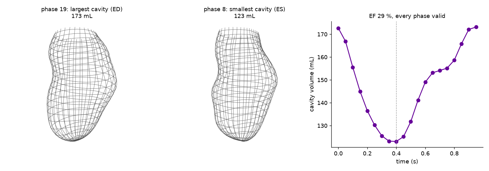
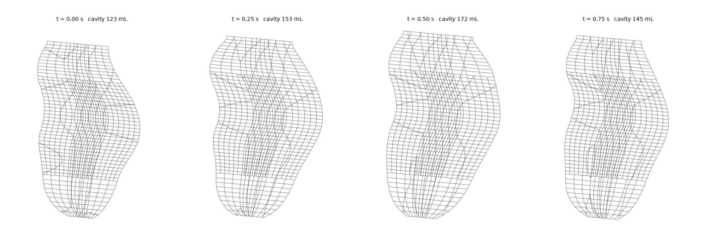

# Step-by-step demo: from a ventricle surface to a beating OpenFOAM mesh

Every command and number below was run on 6 November 2026 with hexmb 0.2.0,
Python 3.12 and OpenFOAM 12 (Foundation) on a laptop, one core per command.
Outputs are quoted as printed.  The data is the CC0 Cardiac Atlas heart that
ships inside the package, so the whole walkthrough needs nothing else.

## 0. Install and check

```bash
pip install "hexmb[all]"          # numpy, scipy, trimesh+rtree, meshio, nibabel, scikit-image, matplotlib
hexmb --help
```

OpenFOAM is only needed for steps 4 and 5 (moving the mesh, `checkMesh`);
everything else is pure Python.

## 1. The bundled heart in one command

```bash
hexmb demo -o out_demo --render
```

```
demo: Cardiac Atlas SCD0000101, 20 phases (CC0), template conformal
  wrote out_demo/lv_endo_phase1.stl (4368 triangles, mm)
  template conformal: 14688 cells per phase, inlet rule 'sectors'
  phase  0  volume  172.7 mL  min cell vol +1.671e+00 mm3  failing cells 0
  ...
  phase 19  volume  173.1 mL  min cell vol +1.645e+00 mm3  failing cells 0
  reference phase 8 (t 0.4000 s, 123.1 mL); EDV 173.1  ESV 123.1 mL  EF 29 %  -> VALID
  wrote out_demo/lv_moving: constant/polyMesh at phase 8, 29 wantedDisplacement time folders (t 0 to 1.4), motion_quality.csv
  wrote out_demo/demo.png
  done: out_demo/lv_moving is an OpenFOAM 12 case (foamRun -solver movingMesh runs the cycle); quality table in out_demo/lv_moving/motion_quality.csv
```

52 s wall.  What it did: read the 20 per-phase Atlas models, built the same
14 688-cell conformal split-hex mesh on every phase, ran the gate on each one,
chose the smallest cavity as the reference mesh, and wrote one OpenFOAM case
whose time folders carry the point displacement from that reference.

```
out_demo/
  lv_endo_phase1.stl        the phase-1 endocardial surface (mm), to try step 2 or 5 on
  demo.png                  surface at ED and ES + the volume curve (figure below)
  lv_moving/
    constant/polyMesh/      the reference (end-systolic) mesh, patches wall / inlet / outlet1
    constant/dynamicMeshDict   mover interpolator, field wantedDisplacement, interpolationScheme spline
    system/controlDict      foamRun, solver movingMesh, startTime 0.4, endTime 1.4
    0/ 0.05/ ... 1.4/       wantedDisplacement (pointVectorField, metres) at every table time
    motion_quality.csv      one row per phase: volume, min cell volume, failing cells, zero-area faces
```



The Atlas model has no RR interval, so the demo spaces the 20 phases evenly over
`--period` (1.0 s by default).  Use `--times` with `hexmb motion` for real timings.

## 2. Your own per-phase surfaces

This is the route for a user's data: one surface file per phase of the same
heart, any of STL / OBJ / PLY / OFF / VTK / VTP / VTU, or one NIfTI mask per
phase.  Surfaces are read in millimetres; give `--units cm` or `--units m` for
files in other units (a mask uses its own affine).  A surface whose apex-to-base
length falls outside 20-250 mm is stopped with a message naming the likely unit;
`--any-size` lets a non-human heart through.  The surface may be open at the base
(the valve plane) or closed.  File names are sorted naturally (`phase_2` before
`phase_10`), so number them in time order.

To try it without your own segmentations, write the bundled phases out as STL:

```bash
hexmb demo -o out_demo --phases-stl phases
```

or, from Python:

```python
import re
from importlib import resources
from hexmb.io.cap import cap_endo_surface
from hexmb.io.stl_surface import write_surface_stl

d = resources.files("hexmb") / "data/cap/SCD0000101"
files = sorted((str(p) for p in d.iterdir() if str(p).endswith(".exnode")),
               key=lambda s: int(re.findall(r"_(\d+)\.model", s)[0]))
for k, f in enumerate(files):
    write_surface_stl(cap_endo_surface(f, NL=60, NT=96), f"phases/lv_phase_{k:02d}.stl")
```

Then:

```bash
hexmb motion --surfaces phases/lv_phase_*.stl --period 1.0 -o case_from_stl
```

```
motion: 20 surface file(s)
  surface lv_phase_00.stl: mesh -> grid 40 x 56, landmarks open: apex (67.4 1.8 6.5) base (-30.7 0.7 0.9), length 98.2 mm, interpolated rays max 0/level
  ...
  template conformal: 14688 cells per phase, inlet rule 'sectors'
  reference phase 8 (t 0.4000 s, 123.1 mL); EDV 173.3  ESV 123.1 mL  EF 29 %  -> VALID
  wrote case_from_stl: constant/polyMesh at phase 8, 29 wantedDisplacement time folders (t 0 to 1.4), motion_quality.csv
```

60 s wall.  Per phase the reader found the landmarks itself (open surface: the
largest boundary loop is the base, the farthest vertex is the apex), cast 40
rings of 56 rays in the frame of the first phase so the grids correspond point
for point, and the builder made the same mesh on each.  "interpolated rays
0/level" means every ray hit the surface; the reader refuses a level where more
than a quarter of the rays miss.

The volumes agree with the model-reader route of step 1 to 0.2 mL (173.3
against 173.1 mL at end-diastole): the ray-cast grid runs from the apex point
to the base plane, with two stations inside the first 3 % of the axis so the
dome at the tip is resolved, and its ring smoothing keeps each ring's area.
`--NL` / `--NT` set the grid, the reader's `apex_offset` / `base_offset` the
first and last cast stations.

## 3. See it move

```bash
hexmb render -o case_from_stl --gif motion_slice.gif --png motion_slice.png
```

```
render: 21 frames from t 0.4 to 1.4 s, cavity 123.1-173.3 mL
```

2 s.  The cut plane is the mesh's own long axis and first transverse
direction (a principal-component fit of the reference points), so no frame file
is needed.  The strip shows four phases through the cycle; the GIF has one frame
per table time.



## 4. Move it in OpenFOAM

```bash
source /opt/openfoam12/etc/bashrc
cd case_from_stl
checkMesh -constant                        # the reference mesh
foamRun -solver movingMesh                 # moves the mesh through the table, no flow
checkMesh -time 1.4                        # any written time
```

The writer sets `deltaT` to a fifth of the table spacing and writes at every
table time.  For this walkthrough `deltaT` was set to 0.01 and `writeInterval`
to 0.25 to keep the output small:

```
Mesh non-orthogonality Max: 64.98  average: 15.88
Max skewness = 3.56 OK.
Mesh OK.
... 100 time steps ... End
```

| written time | cavity from checkMesh | the table's phase volume | max non-orthogonality | max skewness |
|---|---|---|---|---|
| 0.65 s | 153.23 mL | 153.2 mL (phase 13) | 55.9 deg | 2.48 |
| 0.90 s | 172.20 mL | 172.2 mL (phase 18) | 55.2 deg | 2.18 |
| 1.15 s | 145.06 mL | 145.1 mL (phase 3, one period later) | 56.5 deg | 2.72 |
| 1.40 s | 123.09 mL | 123.1 mL (phase 8, the reference, one period later) | 65.0 deg | 3.56 |

`checkMesh` reports "Mesh OK" at every written time; the end-systolic reference
mesh is the most strained (the apex dome is tightest there).  The mesh-only run is quick: the mover interpolates the table, there
is no flow solve, so the 100 steps take 1 s of execution time.  The table runs from the reference time to the reference time plus one
period: the phases up to the reference are repeated one period later, so the
mesh returns exactly to the reference at `endTime` and the run can loop.

To run flow on it, add a `foamRun -solver incompressibleFluid` setup with the
moving-mesh dictionaries kept, a `U` and `p` field, and the `inlet` / `outlet1`
boundary conditions you want; the interpolator mover and the displacement table
stay as written.  The mover interpolates the table with a Catmull-Rom spline
(`--table-interpolation linear` switches to piecewise-linear displacement, which
holds the wall velocity constant between phases and steps the valve flow at
every table time; [VERIFICATION.md](VERIFICATION.md) shows the difference).

## 5. A single phase: `hexmb lv` and `hexmb verify`

```bash
hexmb lv --surface out_demo/lv_endo_phase1.stl -o case_lv
hexmb verify -o case_lv
```

```
lv: out_demo/lv_endo_phase1.stl
  surface lv_endo_phase1.stl: mesh -> grid 40 x 56, landmarks open: apex (67.4 2.3 6.4) base (-30.7 0.7 0.9), length 98.2 mm, interpolated rays max 0/level
  template conformal: coarse ring NT 24 NR 4, body 2x, levels 10/30/12 -> 14688 cells, inlet rule 'sectors'
  cells 14688 (14472 hex + 216 split-hex)  points 16130  min pyramid +2.282e-01 mm3  failing cells 0  zero-area faces 0  cavity 172.5 mL  (VALID)
  wrote case_lv/constant/polyMesh  (one region, 43344 internal faces, patches ['wall', 'outlet1', 'inlet'])
  readback: 16130 pts, 45432 faces (43344 internal), owner<neighbour OK, max |sum Sf| per cell 1.36e-20
  metrics:  non-orthogonality max 54.7 deg (average 15.4, 0 faces > 70), skewness max 2.24 (0 faces > 4), aspect ratio max 3.2, 0 cells with non-positive volume
  [checkMesh] hexahedra:     14472
  [checkMesh] polyhedra:     216
  [checkMesh] Number of regions: 1 (OK).
  [checkMesh] Min volume = 1.82735e-09. Max volume = 8.38424e-08.  Total volume = 0.000172468.  Cell volumes OK.
  [checkMesh] Mesh non-orthogonality Max: 54.6914 average: 15.367
  [checkMesh] Max skewness = 2.24233 OK.
  [checkMesh] Mesh OK.
```

The `metrics:` line is hexmb's own (OpenFOAM's definitions, no OpenFOAM
needed); `checkMesh` follows when OpenFOAM is present and agrees to the printed
precision.

Other inputs for `--surface`: a NIfTI mask (`--label` picks the blood-pool
label), a Cardiac Atlas `.exnode`, a saved `.npz` grid.  `--template single`
gives the one-block O-grid chamber of hexmb 0.1 with the same valve sectors.

## 6. The same from Python

```python
from hexmb.io.surface import grid_from_file
from hexmb.templates.conformal_lv import ConformalLVConfig, build_conformal_lv, polymesh_quality
from hexmb.services.motion import build_lv_motion

G, axis, e1, e2, mu, info = grid_from_file("out_demo/lv_endo_phase1.stl")
cfg = ConformalLVConfig(body_levels=60)          # twice the axial resolution in the body
mesh = build_conformal_lv(G, axis, e1, e2, cfg, mu=mu)
print(polymesh_quality(mesh))                   # cells, min pyramid, failing cells, zero-area faces, mL
mesh.write("case_lv_fine")                      # constant/polyMesh with wall / inlet / outlet1

grids = [grid_from_file(f, frame=(axis, e1, e2))[0] for f in sorted(glob("phases/*.stl"))]
res = build_lv_motion(grids, times, cfg=cfg, period=1.0, out="case_moving")
res["valid"], res["volumes_mL"], res["quality"]
```

## 7. What the gate checks, and what the builder does when a phase fails

A phase passes when every cell has a positive signed pyramid volume on every
face (the pyramid from the cell centre to the face, with the face oriented
outward by construction), no face has zero area, and for the single template
every scaled Jacobian is positive.  The signed pyramid test sees an inverted
cell and a cell folded past its centre; an unsigned volume sees neither, and
`checkMesh` cannot see a fold once the writer has turned every face outward.
`checkMesh` is run afterwards as an independent cross-check.

Before building, the builder screens every ring of every phase: the polar angle
of a ring's points about its own centre must advance in one direction and total
one turn.  A ring that passes through the long axis (a Cardiac Atlas fit with
`lambda <= 0`), overlaps itself, runs the wrong way or collapses to a point
fails that test and cannot be meshed.  What happens next depends on where the
bad rings are, and the builder prints every step:

```
  auto_trim: base_cut 1.000 -> 0.951: rows 38-39 of 40 do not wind once about the axis on phase(s) 6 7 (the surface crosses itself at the base rim); the base now stops at the last good row
  phase  0  volume  180.5 mL  min cell vol +8.797e-01 mm3  failing cells 0
  ...
  phase  6  volume   90.2 mL  min cell vol +3.383e-01 mm3  failing cells 0
  phase  7  volume   87.5 mL  min cell vol +3.761e-01 mm3  failing cells 0
  ...
  reference phase 7 (t 0.3500 s, 87.5 mL); EDV 180.5  ESV 87.5 mL  EF 52 %  -> VALID
```

(Cardiac Atlas subject SCD0000601, which failed on phase 6 before this was
automatic.)

| what the builder finds | what it does by itself | switch |
|---|---|---|
| bad rings at the top of the surface | moves `base_cut` down to the last good row (the smallest cut over all phases, so every phase keeps one valve plane) | `--no-auto-trim` |
| bad rings at the apex | moves `apex_trim` up past them | `--no-auto-trim` |
| cells fail the gate at the base rim (axial fraction > 0.9), rings fine | lowers `base_cut` by 0.03 and rebuilds every phase, at most three times | `--no-auto-trim` |
| cells fail the gate in the apex zone (axial fraction < 0.3) | raises `apex_trim` by 0.02 and rebuilds, at most three times | `--no-auto-trim` |
| bad rings in the middle of the ventricle, or cells failing away from a rim | marks the phase `failed` (no trim can fix a surface that crosses itself there) and replaces it by the linear interpolation in time between its nearest valid neighbours, then gates that mesh; the quality table says `filled` and names the neighbours | `--no-fill` |

Every change is listed in `motion_adjustments.txt` next to `motion_quality.csv`,
and the `status` / `note` columns of the table say per phase whether it was
built as given (`ok`), filled (`filled`) or left failing (`failed`).  A case
with a `failed` phase is INVALID.  To set the knobs by hand instead, pass
`--base-cut` / `--apex-trim` with `--no-auto-trim`; `--NT-c 16` (a coarser
apex ring) is the other option for a pinched apex.

| other messages | cause | fix |
|---|---|---|
| surface extent ... looks like metres | input in m, not mm | scale by 1000 |
| mask holds N labels | multi-label segmentation | `--label <blood pool>` |
| more than NT/4 rays interpolated | the surface is not star-shaped about the axis at that level, or landmarks are off | `--apex/--base`, close the surface |
| phase k produced a different topology | the phase surfaces do not correspond | same `--NL/--NT` and frame on every phase |

## 8. Timings (laptop, one core)

| step | wall time |
|---|---|
| `hexmb demo` (20 phases, 14 688 cells each, gate + case) | 50 s (52 s with `--metrics`) |
| `hexmb export` (29 `.vtu` + 3 `.vtp` + `.pvd`, 86 MB) | 30 s |
| `hexmb flow` (write the flow case) | under 1 s |
| `hexmb motion` on 20 STL files (read + ray-cast + build + gate + case) | 60 s |
| `hexmb render` (21 frames) | 2 s |
| `foamRun -solver movingMesh`, 100 steps (mesh motion only, no flow) | 1 s |
| `hexmb lv` single phase (read + ray-cast + build + gate + write) | 6 s |

## 9. See it in ParaView: `hexmb export`

```bash
hexmb export -o out_demo/lv_moving              # or: hexmb demo ... --vtk / hexmb motion ... --vtk
```
```
  wrote out_demo/lv_moving/vtk: 29 .vtu (14688 cells), 3 patch .vtp, motion.pvd
```

`vtk/motion.pvd` is a ParaView time series: one `mesh_<time>.vtu` per table
time with the point displacement (`wantedDisplacement`) and the cell volume as
cell data, and `boundary_wall.vtp`, `boundary_inlet.vtp`, `boundary_outlet1.vtp`
for the patches.  The hexahedra are VTK hexahedra and the 216 split-hex
transition cells are VTK polyhedra, so the file opens in any VTK reader (no
OpenFOAM installation, no `foamToVTK`).  Arrays are base64 binary; `--ascii`
writes them as text (67 MB instead of 86 MB for this case, since the ASCII
numbers are shorter than the 8-byte doubles).

An all-hexahedral mesh (`hexmb pipe`, `hexmb elbow`, `--template single`) also
exports as an Abaqus / CalculiX input deck:

```bash
hexmb pipe --length 100 --radius 10 -o case_pipe
hexmb export -o case_pipe --inp case_pipe/pipe.inp --scale 1000     # polyMesh is in metres; 1000 -> mm
```
```
  wrote case_pipe/pipe.inp (Abaqus/CalculiX C3D8, node sets per patch)
```
The deck holds `*NODE`, `*ELEMENT, TYPE=C3D8, ELSET=ALL` with the C3D8 corner
order, and one `*NSET` per patch (`inlet`, `outlet`, `wall`) for boundary
conditions.  The split-hex LV template is refused with a message (a nine-face
cell has no C3D8 form); write it as VTK instead.

## 10. Flow on the moving mesh: `hexmb flow`

```bash
source /opt/openfoam12/etc/bashrc
hexmb flow -o out_demo/lv_moving --window diastole --procs 4
out_demo/lv_moving/Allrun 4
```
```
  flow case (diastole): t 0.4 -> 0.95 s, open valve inlet, closed outlet1; nu 3.77e-06 m2/s, maxCo 1.0, maxDeltaT 0.001 s; run with out_demo/lv_moving/Allrun [n_procs]
```

The case is the usual prescribed-motion left-ventricle flow model: the wall
motion alone drives the flow, the open valve is a zero-total-pressure opening
(`totalPressure p0 0` + `pressureInletOutletVelocity`), the closed valve and
the wall are moving walls (`movingWallVelocity` + `fixedFluxPressure`), blood
viscosity 3.77e-6 m^2/s, laminar.  `diastole` runs from the end-systolic
reference mesh to the next end-diastole with the mitral `inlet` open;
`systole` needs a case built with `--reference ed` and runs end-diastole to
end-systole with the aortic `outlet1` open (the mesh mover needs zero
displacement at the start time, which is why each window starts at its own
reference).  `flow_setup.txt` records every choice.  Function objects write
`postProcessing/Qin` (or `Qout`), `Umax`, `KE2` (twice the kinetic energy per
unit density), the wall shear stress at write times and a `checkMesh` of the
moving mesh at every write time, so the run tells you itself whether the mesh
stayed sound.  `Allrun` runs `decomposePar -force -time '0:'`, `foamRun -parallel`
and `reconstructPar -newTimes`, and prints the last Courant number.  The
`-time '0:'` matters: the `interpolator` mover reads `wantedDisplacement` from
every table time, and a plain `decomposePar` copies only the start-time folder,
so the processors would hold no tables and the mesh would never move.  That
failure is silent (Courant number 0, zero valve flow, exit code 0), so `Allrun`
checks for it and exits with a CHECK line.

What the runs give on the bundled heart at three mesh levels, with the error
estimates, is in [VERIFICATION.md](VERIFICATION.md).

## 11. From a segmentation mask

```bash
hexmb lv --surface lv_mask.nii.gz --label 1 -o case_lv                 # auto: slices for thick slices, marching for isotropic
hexmb lv --surface lv_mask.nii.gz --label 1 --mask-method slices -o case_lv
hexmb motion --surfaces phase_*.nii.gz --label 1 --period 0.9 -o case_moving
```

A short-axis cine stack has 1.0-1.5 mm pixels and 8-10 mm slices.  The
slice-by-slice reader takes the blood-pool outline of every slice (largest
region, holes filled, so the papillary muscles count as cavity as in the
clinical rule), resamples it on `NT` angles about the slice's own centroid,
puts the apex point half a slice beyond the apical slice and the base ring half
a slice beyond the basal one (the stack's Simpson's-rule volume), and runs a
monotone cubic through the rings for the rows in between.  An isotropic mask
(CT) goes through marching cubes and the ray cast.  The volume each route
recovers on synthetic masks of the bundled heart, against the exact surface, is
in [VERIFICATION.md](VERIFICATION.md#input-verification-the-mask-readers).
