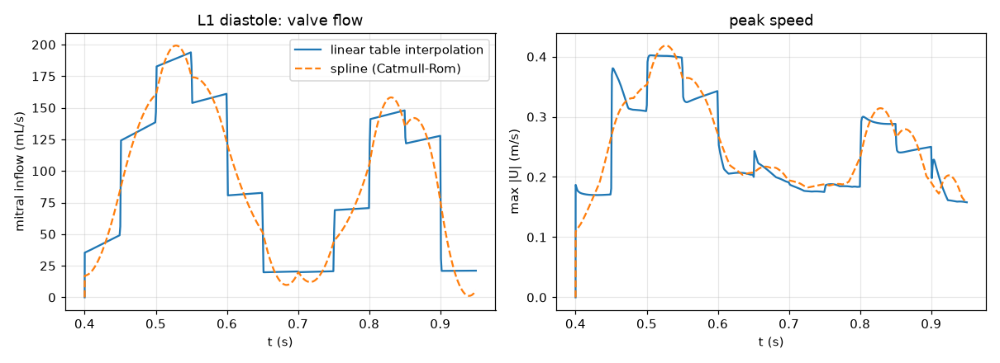
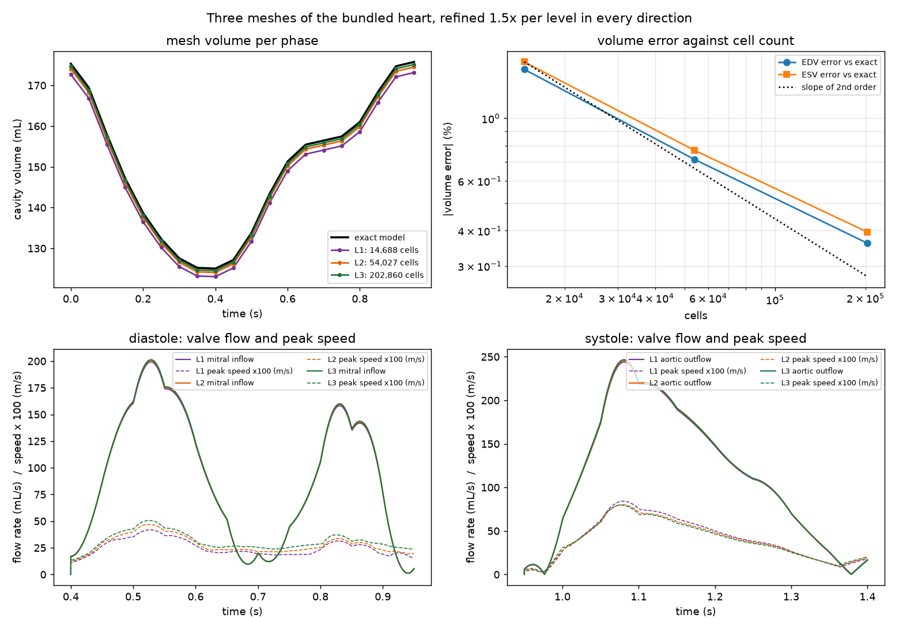
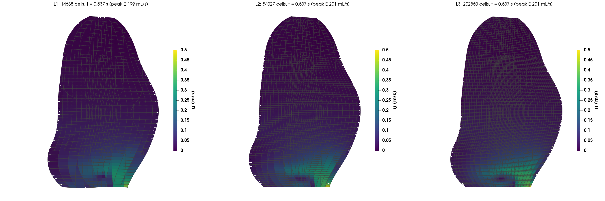
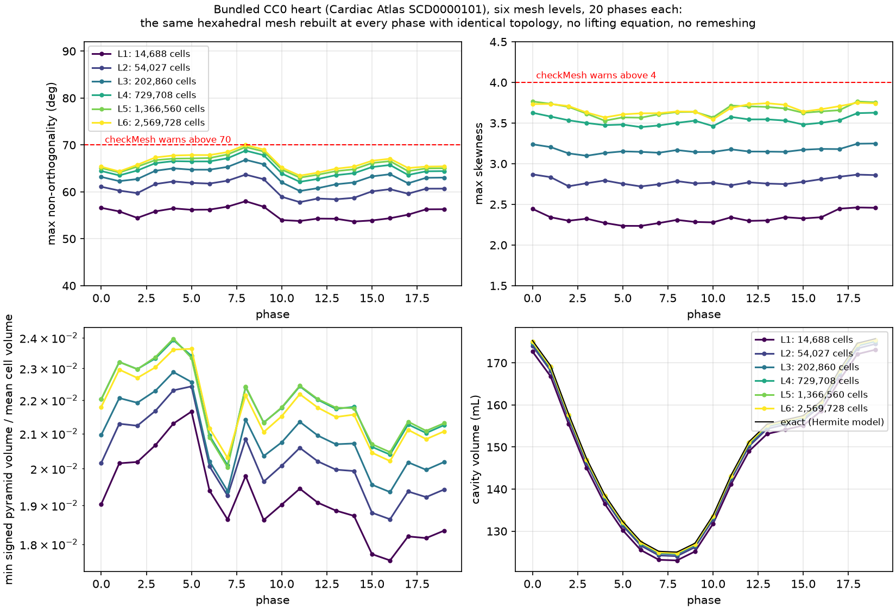
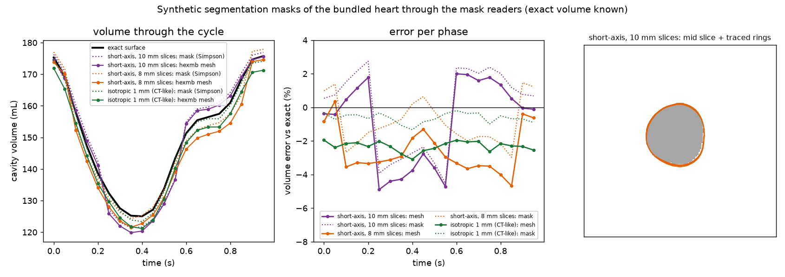

# Verification: how far the numbers can be trusted

This page is the *calculation verification* part of a credibility case in the
sense of ASME V&V 40 (Assessing Credibility of Computational Modeling through
Verification and Validation: Application to Medical Devices).  V&V 40 asks a
model to state its context of use, to pick a question of interest, to grade the
risk of a wrong answer, and then to show evidence under fixed headings: code
verification, calculation verification (discretisation error), validation
against measurement, and applicability.  A mesh generator supplies the first
half of that chain.  What it owes the user is the size of the error its
discretisation puts into the quantities the solver will report, measured on a
case whose exact answer is known, and the trend of that error with refinement.

Everything below runs on the **bundled CC0 heart** (Cardiac Atlas subject
SCD0000101, 20 phases) with `scripts/verification_study.py` (three levels,
volume and flow) and `scripts/quality_through_cycle.py` (six levels, mesh
quality at every phase), so anyone can repeat it; the figures and tables are
produced by `scripts/verification_figures.py` and
`scripts/quality_through_cycle_figures.py` from the studies' `results.json`.

## Context of use and quantities of interest

`hexmb` builds the moving all-hexahedral mesh of a **left-ventricular blood
pool** whose wall motion is prescribed from imaging, for an incompressible
flow solve in OpenFOAM (`foamRun -solver incompressibleFluid` on an
`interpolator` moving mesh).  The quantities a user of such a model reads are:

| quantity | why it matters | where the mesher enters |
|---|---|---|
| cavity volume per phase (EDV, ESV, EF) | the clinical measure; it drives the flow through the valves | the mesh is an inscribed polygonal approximation of the surface; the apex tip is trimmed |
| valve flow rate `Q(t)` | by continuity it equals the rate of change of cavity volume | the time derivative of the mesh volume |
| peak speed `max \|U\|` and kinetic-energy integral `0.5 int \|U\|^2 dV` | the summary numbers of an intraventricular flow study | solver discretisation on the moving mesh; the pointwise maximum sits in the valve-rim cell (see the flow section) |
| wall shear stress | a derived near-wall quantity | wall-cell size and face orthogonality |

The first two are *geometric*: the mesh fixes them regardless of the solver,
so they can be verified against the exact surface.  The last two need a flow
solve and are verified by the trend across three meshes.

## The three meshes

Each level refines the previous one by about **1.5x in every direction**,
including the surface sampling the mesh is built from, so the ratio of cell
counts is close to 1.5^3 = 3.4 and the grid-convergence estimate of Celik et
al. (2008, *J. Fluids Eng.* 130:078001) applies with `r = (N_fine / N_coarse)^(1/3)`.
Level 1 is the default template; nothing else is changed between levels.

| level | surface NL x NT | ring NT_c / NR_c | levels apex/body/base | cells | points | build (20 phases) | max non-orth. | faces > 70 deg | max skewness | faces > 4 | max aspect |
|---|---|---|---|---|---|---|---|---|---|---|---|
| L1 | 40 x 56 | 24 / 4 | 10/30/12 | 14,688 | 16,130 | 55 s | 58.0 deg | 0 | 2.46 | 0 | 3.6 |
| L2 | 60 x 84 | 36 / 6 | 15/45/18 | 54,027 | 57,325 | 217 s | 63.7 deg | 0 | 2.87 | 0 | 4.0 |
| L3 | 90 x 128 | 56 / 9 | 22/68/27 | 202,860 | 210,675 | 786 s | 66.8 deg | 0 | 3.25 | 0 | 4.4 |

Every phase of every level passes the signed-pyramid gate without any trim
beyond the default 2 % apex trim (the builder reports a trim when it has to
make one; none was made here).  The checkMesh-style metrics in the table are
computed by `hexmb` itself with OpenFOAM's definitions and agree with
`checkMesh` to the printed precision on the level-1 mesh (max
non-orthogonality 58.0 deg, max skewness 2.46 at end-systole).

## Geometric error: cavity volume

The Cardiac Atlas model is an analytic surface (bicubic Hermite in prolate
spheroidal coordinates), so its exact cavity volume is known: the surface is
sampled at 400 x 512 and integrated, which converges to five figures.  The mesh
volume at each level is the sum of its cell volumes (the same number
`checkMesh` prints as the total volume).

| level | EDV (mL) | error | ESV (mL) | error | mean error over 20 phases | sampled-surface EDV |
|---|---|---|---|---|---|---|
| L1 | 173.14 | -1.49 % | 123.06 | -1.58 % | -1.53 % | 175.18 |
| L2 | 174.50 | -0.72 % | 124.08 | -0.77 % | -0.74 % | 175.50 |
| L3 | 175.12 | -0.36 % | 124.55 | -0.40 % | -0.38 % | 175.65 |
| exact | 175.75 | | 125.04 | | | |

Two things make the mesh smaller than the surface, and both shrink with
refinement at second order: a ring of `N` points is an inscribed polygon whose
area is `(N / 2 pi) sin(2 pi / N)` of the circle's (0.9886 for the 24-point
coarse rings of the apex and base caps, 0.9971 for the 48-point body rings,
0.9979 for the 56-point sampled surface), and the first 2 % of the long axis at
the apex is capped by a disc (about 0.1 mL on this heart).  The Richardson
extrapolation below treats the three levels as a sequence in one parameter and
recovers the exact volume to within the extrapolation's own uncertainty, which
is the check that the discretisation behaves as a converging method should.

| quantity | L1 (default) | L2 | L3 | observed order p | extrapolated | exact | error of L1 vs extrapolated | GCI of L1 | GCI of L3 | note |
|---|---|---|---|---|---|---|---|---|---|---|
| EDV (mL) | 173.136 | 174.497 | 175.119 | 1.83 | 175.622 | 175.754 | 1.42 % | 1.78 % | 0.36 % | |
| ESV (mL) | 123.060 | 124.077 | 124.545 | 1.81 | 124.929 | 125.040 | 1.50 % | 1.88 % | 0.39 % | |

Read the grid-convergence index (GCI) as the error band a user should put
around the level's number: the default mesh's end-diastolic volume carries
about 1.5 % of discretisation error, the finest mesh's a few tenths of a
percent.  Those are smaller than the segmentation uncertainty of the surface
itself (one voxel of cine MRI, 1.0-1.5 mm, moves the volume of a 170 mL
ventricle by 4-6 %), which is the right order for a mesher: its error should
not be the one that limits the study.

## Flow: a wall-driven filling and ejection on each mesh

`hexmb flow` turns the moving-mesh case into the usual prescribed-motion LV
flow model: the wall motion alone drives the flow, an open valve is a
zero-total-pressure opening (`totalPressure p0 0` with
`pressureInletOutletVelocity`), a closed valve is a moving wall, no leaflets,
laminar, blood viscosity 3.77e-6 m^2/s.  Two windows are run on every level:
**diastole** from end-systole to end-diastole with the mitral `inlet` open, and
**systole** from end-diastole to end-systole with the aortic `outlet1` open
(the mesh mover needs zero displacement at the start, so each window starts at
its own reference mesh).  Numerics: PIMPLE with `correctPhi` and
`correctMeshPhi`, Euler in time at Courant number 1 with `maxDeltaT` 1 ms,
`linearUpwind grad(U)` convection, `limited corrected 0.33` Laplacians for the
split-hex transition.  Function objects log the valve flow rate, the peak
speed, the kinetic-energy integral and `checkMesh` of the moving mesh at every
write time.

**How the table is interpolated in time matters.**  The `interpolator` mover
interpolates the displacement between table times.  With `linear` the wall
velocity is constant between phases and jumps at every table time, so the
valve flow of a 20-phase table is a staircase and the peak speed spikes after
each jump.  With `spline` (Catmull-Rom through the same table) the wall velocity
is continuous.  On L1 in diastole the largest step-to-step change of the inflow
falls from 97 to 17 mL/s, the peak inflow moves from a 50 ms plateau at
193.8 mL/s to a smooth peak of 199.2 mL/s at 0.529 s, and the filled volume is
the same both ways (50.08 mL, continuity).  hexmb writes `spline` since this
study (`--table-interpolation linear` restores the old behaviour); the runs
below use it.

<p align="center"></p>

| level | window | time steps | dt (ms) | Courant max | wall time | peak flow (mL/s) | peak speed (m/s) | peak 2KE/rho (m^5/s^2) | moving-mesh checks failed | run |
|---|---|---|---|---|---|---|---|---|---|---|
| L1 | diastole | 580 | 0.01-0.98 | 0.28 | 0.7 min | 199.2 | 0.418 | 1.033e-06 | 0 of 20 | ok |
| L1 | systole | 480 | 0.01-0.98 | 0.74 | 0.7 min | 244.0 | 0.842 | 1.784e-06 | 0 of 20 | ok |
| L2 | diastole | 580 | 0.01-0.98 | 0.51 | 2.7 min | 200.7 | 0.468 | 1.050e-06 | 0 of 20 | ok |
| L2 | systole | 494 | 0.01-0.98 | 1.02 | 2.2 min | 245.7 | 0.802 | 1.719e-06 | 0 of 20 | ok |
| L3 | diastole | 580 | 0.01-0.98 | 0.83 | 11.4 min | 201.3 | 0.506 | 1.093e-06 | 0 of 20 | ok |
| L3 | systole | 604 | 0.01-0.98 | 1.01 | 11.1 min | 246.6 | 0.797 | 1.698e-06 | 0 of 20 | ok |

Three kinds of answer come out of these runs.

* **The valve flow rate converges like the volume.**  By continuity the flow
  through the open valve is the rate of change of the cavity volume, so it
  inherits the geometric error: observed order 2.1 (inflow) and 1.7 (outflow),
  a GCI of 1.5-1.8 % on the default mesh and 0.2-0.4 % on L3, the same
  fractions as EDV and ESV.
* **The kinetic-energy integral converges at second order** (p 2.1 in
  diastole, 2.6 in systole), with a GCI of 3-7 % on the default mesh and
  0.8-3 % on L3.  This is the solver's answer on the moving mesh and the
  number to quote as discretisation uncertainty for an integral flow result
  from this template.
* **The pointwise peak speed does not converge on these meshes**, so the GCI
  printed for it is not a usable uncertainty.  `scripts/flow_speed_distribution.py`
  locates the fastest cell in the written fields.  In diastole it is always
  the rim cell where the open mitral patch meets the wall (its distance to the
  nearest valve-patch point equals its distance to the nearest wall point, one
  cell: 2.3, 1.5 and 0.9 mm on L1-L3), and its speed rises as that cell
  shrinks (0.41, 0.46, 0.49 m/s at the written time nearest peak E), as the
  flow round a sharp edge does.  In systole the fastest cell sits in the core
  of the ejection jet, 1.5-4 mm from the centre of the aortic opening, and
  falls from 0.84 to 0.78 m/s.  Measures of the speed *distribution* on the
  same fields are mesh-independent:

| written time nearest the peak | 99th percentile of \|U\| (m/s), L1 / L2 / L3 | volume-weighted mean \|U\| (m/s) | max \|U\| (m/s) |
|---|---|---|---|
| diastole, 0.5375 s (peak E) | 0.273 / 0.271 / 0.275 | 0.054 / 0.054 / 0.054 | 0.41 / 0.46 / 0.49 |
| systole, 1.085 s (peak ejection) | 0.359 / 0.358 / 0.355 | 0.063 / 0.063 / 0.063 | 0.84 / 0.79 / 0.78 |

So a user of this template should report flow rates, the kinetic-energy
integral, or a percentile or area-mean speed, and treat `max |U|` from any
single mesh as a property of the rim cell rather than of the flow.  If the
pointwise maximum is the quantity of interest, the valve rim needs its own
refinement study with a resolved edge (a rounded or layered rim), which is
outside this page.

| quantity | L1 (default) | L2 | L3 | observed order p | extrapolated | exact | error of L1 vs extrapolated | GCI of L1 | GCI of L3 | note |
|---|---|---|---|---|---|---|---|---|---|---|
| peak mitral inflow (mL/s) | 199.216 | 200.704 | 201.305 | 2.11 | 201.697 | - | 1.23 % | 1.54 % | 0.24 % | |
| peak aortic outflow (mL/s) | 243.967 | 245.746 | 246.625 | 1.65 | 247.447 | - | 1.41 % | 1.77 % | 0.42 % | |
| peak speed, diastole (m/s) | 0.4183 | 0.4683 | 0.5061 | 0.67 | 0.6164 | - | 32.14 % | 52.88 % | 27.25 % | GCI of 53 %: the fastest cell is the valve-rim cell and grows with refinement (see below) |
| peak speed, systole (m/s) | 0.8422 | 0.802 | 0.7974 | 5.00 | 0.7968 | - | 5.71 % | 7.09 % | 0.09 % | observed order 5.00 outside 0.5-4: the levels are not in the asymptotic range for this quantity |
| peak 2KE/rho, diastole (m^5/s^2) | 1.033e-06 | 1.05e-06 | 1.093e-06 | 2.12 | 1.121e-06 | - | 7.85 % | 3.30 % | 3.21 % | |
| peak 2KE/rho, systole (m^5/s^2) | 1.784e-06 | 1.719e-06 | 1.698e-06 | 2.56 | 1.688e-06 | - | 5.73 % | 7.03 % | 0.76 % | |

<p align="center"></p>

<p align="center"></p>

*Speed on the long-axis mid-plane at the written time nearest peak E on the
three levels, one colour scale (0-0.5 m/s).  The flow pattern and the inflow
jet are the same on all three; the single bright cell at the edge of the
mitral opening (bottom right of each panel) is the maximum-speed cell, which
shrinks and brightens with refinement.*

## Quality through the cycle at six levels

The block-structured LV meshes of Imperial College (2003-2008) and Karlsruhe
(2009) stopped at a few hundred thousand cells: above that their quality could
not be held through the contraction, and nodes twisted between phases (the
state of the field in `paper.md` has the references).  The question they left
open is whether a body-fitted hexahedral mesh can keep its quality through a
full contraction without a lifting equation and without remeshing.
`scripts/quality_through_cycle.py` puts the conformal template to that test on
the bundled heart.  It carries the three levels above and adds three more under
the same rule, every direction refined together and nothing set per level or
per phase; L4 and L6 continue the 1.5x series from L3 and L5 sits between them.

| level | surface NL x NT | ring NT_c / NR_c | levels apex/body/base | cells | points | build per phase | metrics per phase | peak memory |
|---|---|---|---|---|---|---|---|---|
| L4 | 135 x 192 | 84 / 14 | 33/102/41 | 729,708 | 747,606 | 119 s | 50 s | 3.3 GB |
| L5 | 160 x 232 | 104 / 17 | 40/125/50 | 1,366,560 | 1,393,709 | 230 s | 102 s | 6.1 GB |
| L6 | 200 x 288 | 128 / 21 | 50/153/61 | 2,569,728 | 2,610,886 | 410 s | 195 s | 11.1 GB |

One phase is in memory at a time.  For each of the 20 phases the script records
the signed-pyramid gate (smallest pyramid, cells with a non-positive pyramid,
zero-area faces), the checkMesh-style metrics with OpenFOAM's definitions
(maximum and average non-orthogonality, faces above 70 deg, maximum skewness,
faces above 4, maximum aspect ratio, and the 50 / 90 / 99 / 99.9 percentiles of
the per-face values), the cavity volume against the exact Hermite volume, the
build time and peak memory, and the azimuth of every wall node about the long
axis relative to end-systole.  The connectivity is taken from the first build
(end-systole); the cell, point, hexahedron and split-hex counts are compared at
every phase, and at end-diastole the cell-to-vertex lists and every internal
face with its owner and neighbour are compared element by element, and the
boundary faces as a set (the recorded run compared the counts at every level;
the element-by-element comparison was made at L1 and L4).  The end-systolic mesh of each new level is also
written as a `polyMesh` and passed
through `checkMesh`.  Times are with two threads on a laptop; writing the
end-systolic `polyMesh` took 274, 512 and 917 s (an ASCII writer) and
`checkMesh` itself 5, 10 and 23 s.  The three new levels took 6.7 h of compute
in all, run as two jobs side by side.

| level | cells | points | build s / phase | peak RSS GB | worst max non-orth. deg (phase) | faces > 70 deg | worst max skewness | faces > 4 | worst max aspect | min pyramid / mean cell volume | wall-node drift RMS (max) deg | all phases pass | same topology | checkMesh at end-systole |
|---|---|---|---|---|---|---|---|---|---|---|---|---|---|---|
| L1 | 14,688 | 16,130 | 3 | - | 58.0 (8) | 0 | 2.46 | 0 | 3.6 | 0.018 | - | yes | yes | - |
| L2 | 54,027 | 57,325 | 11 | - | 63.7 (8) | 0 | 2.87 | 0 | 4.0 | 0.019 | - | yes | yes | - |
| L3 | 202,860 | 210,675 | 39 | - | 66.8 (8) | 0 | 3.25 | 0 | 4.4 | 0.019 | - | yes | yes | - |
| L4 | 729,708 | 747,606 | 119 | 3.3 | 68.8 (8) | 0 | 3.63 | 0 | 5.2 | 0.020 | 1.70 (72) | yes | yes | Mesh OK (68.8 deg, skew 3.50) |
| L5 | 1,366,560 | 1,393,709 | 230 | 6.1 | 69.6 (8) | 0 | 3.77 | 0 | 5.3 | 0.020 | 1.64 (71) | yes | yes | Mesh OK (69.6 deg, skew 3.64) |
| L6 | 2,569,728 | 2,610,886 | 410 | 11.1 | 70.0 (8) | 0 | 3.75 | 0 | 5.6 | 0.020 | 1.67 (79) | yes | yes | Mesh OK (70.0 deg, skew 3.64) |

L1 to L3 are carried over from the three-level study (built on one thread,
without the drift columns; their end-systolic and end-diastolic cases were
`checkMesh`-clean there).  The same-topology column is the count comparison at
every phase; the element-by-element comparison at end-diastole was run at L1
and L4.

<p align="center"></p>

*Six levels through the 20 phases: maximum non-orthogonality with the 70 deg
line at which `checkMesh` warns, maximum skewness with the 4 line, the smallest
signed pyramid volume as a fraction of the mean cell volume, and the cavity
volume against the exact model.  End-systole is phase 8.*

What the 120 phase builds show:

* **Every phase of every level passes the gate.**  No cell has a non-positive
  pyramid and no face has zero area.  The smallest signed pyramid volume stays
  between 0.018 and 0.024 of the mean cell volume at every level and phase, a
  little larger at the fine levels than at L1: the margin is scale-free, so
  refinement does not eat it.  Its lows are at phase 7, just before
  end-systole, and at phase 16.
* **The connectivity is the same at every phase.**  It is generated from the
  template parameters alone; the cell, point, hexahedron and split-hex counts
  agree at all 120 builds, and between end-diastole and end-systole the
  cell-to-vertex lists and all internal faces with their owners and neighbours
  are identical element by element, and the boundary faces are the same set
  (checked at L1 and L4).  The one thing that does change with the phase is
  the label of a few base-cap faces as wall, inlet or outlet, which the valve
  classifier assigns from the geometry of each phase: at L1, 2 of the 2,088
  boundary faces carry a different label at end-diastole than at end-systole
  (wall 1,995 / 1,995, outlet 37 / 38, inlet 56 / 55), and at L4, 52 of the
  26,082 (wall 24,747 / 24,735, outlet 522 / 551, inlet 813 / 796).  The
  moving-mesh case takes the labelling of
  its reference phase, so the written case has one set of patches.
* **Non-orthogonality creeps up with refinement and stays under 70 deg.**  The
  worst face is at end-systole at every level: 58.0, 63.7, 66.8, 68.8, 69.6
  and 69.99 deg.  The increments per 1.5x step shrink (5.7, 3.1, 2.0, 1.2 deg),
  and none of the 120 builds has a face over the 70 deg line at which
  `checkMesh` warns (it fails a mesh at 90 deg).  The maximum belongs to a few
  faces in the apex cap: at L4 the 512 faces over 60 deg (of 2.2 million) all
  lie within 4 mm of the apex and 6-11 mm from the axis, and the worst face sits
  2 mm above the apex at a radius of 8 mm, in a plain hexahedron.  At
  end-systole the median face non-orthogonality is 9.2-9.3 deg, the 99th
  percentile 36 deg and the 99.9th 51-52 deg at L4, L5 and L6 alike, and the
  average over all faces stays between 12.8 and 13.4 deg at every level and
  phase.  A further 1.5x step (about 5.8
  million cells) would probably put a handful of end-systolic faces just over
  70 deg on this subject.  That is a `checkMesh` warning the solver's
  non-orthogonal correctors exist for; 8 of the 45 cohort subjects in
  `DATA.md` already show it at the default level.
* **Skewness and aspect ratio are flat.**  Maximum skewness 3.5-3.8 over the
  cycle at the new levels (the warning is at 4; zero faces above it) with a
  99.9th percentile of 0.5-0.8; the maximum is a boundary-face value in the
  same apex region (within 2.5 mm of the apex), and at end-systole on L4 no
  internal face is above 0.63.  Maximum aspect ratio 5.2-5.6 over the cycle
  with a 99.9th percentile of 3.0-3.3.
* **The cavity volume converges.**  The largest error against the exact
  Hermite volume over the 20 phases falls from 1.61 % at L1 through 0.79, 0.41,
  0.26 and 0.22 to 0.19 % at L6; it is the inscribed-polygon loss of the volume
  section, shrinking with the cell size.
* **`checkMesh` agrees with the built-in metrics.**  Mesh OK at end-systole on
  L4, L5 and L6, with maximum non-orthogonality 68.7878 / 69.5579 / 69.9869
  deg, maximum skewness 3.50259 / 3.63539 / 3.64238 and maximum aspect ratio
  4.86974 / 5.11086 / 5.25476, against 68.7879 / 69.5578 / 69.9871, 3.5026 /
  3.6354 / 3.6424 and 4.8697 / 5.1109 / 5.2548 from `hexmb`.  (The first pass
  of the run wrote the cases without a `system/controlDict`, so `checkMesh`
  exited before its final line and the helper read that as "0 failed checks".
  The helper now keeps `log.checkMesh` in the case and reports `ran: false`
  when the final line is missing, the script writes the dictionaries, and the
  three cases were rerun on the same written meshes.)
* **Wall nodes keep their circumferential position.**  Imperial and Karlsruhe
  saw twist between phases.  Here a wall node is placed by ring index and angle
  in the fixed frame of phase 0, so its azimuth about the long axis should
  change through the cycle only as much as the sampled surface itself does.
  `scripts/wall_node_drift.py` measures that node by node against end-systole,
  on the 4,652 wall nodes of L2 at every phase.  Nodes more than 10 mm from the
  axis (93 % of them) change azimuth by at most 6.8 deg (RMS 0.20 deg, 99th
  percentile 0.34 deg), which is the size of the circumferential motion of the
  Cardiac Atlas surface sample points themselves (RMS 0.2 deg, maximum
  1.8 deg).  Over all wall nodes more than 2 mm from the axis the tangential
  slip is 0.14 mm RMS and 0.17 mm at the 99th percentile, against node
  displacements of up to 12.8 mm (RMS 5.5 mm).  The largest values, 2.5 mm of
  slip and 60 deg, belong to a few nodes within 2.5 mm of the axis at the
  closed top of the ring grid, 91 mm above the apex, where the angle is
  ill-conditioned and the cap moves 6 mm with the valve plane; 0.5 % of the
  nodes slip more than 1 mm.  At L4 (24,925 wall nodes) the same measure at
  phases 0 and 18 gives 4.1-4.7 deg maximum and 0.18-0.19 deg RMS beyond
  10 mm, and a slip of 0.13-0.14 mm RMS, 0.14-0.16 mm at the 99th percentile
  and 2.5-2.8 mm at the same base-cap node.  At the phases farthest from
  end-systole (0, 18 and 19) the RMS azimuth change over all wall nodes beyond
  2 mm (the `wall_drift` columns of `results.json`) is 1.7-1.8 deg at L2 and
  1.5-1.7 deg at L4-L6, so the statistic does not depend on the level.

What this section does not settle: it is one subject; there is no flow solve on
L4-L6 (the flow verification above stops at L3); and 2.57 million cells is where
this laptop's memory made the study stop (11 GB per phase), which says nothing
about where the template stops.

## Input verification: the mask readers

A segmentation mask is the common clinical starting point, and reading it is
a discretisation step of its own.  `scripts/synthetic_masks.py` voxelises the
exact surface of the bundled heart at three scanner-like resolutions, reads
the masks back with the two mask readers, meshes every phase and compares
the mesh volume with the exact one:

| masks | voxels (mm) | shape | reader | reader + mesh time | valid phases | mesh EDV / ESV (mL) | mask (Simpson) EDV / ESV | mesh volume error vs exact: mean (range) |
|---|---|---|---|---|---|---|---|---|
| sa10 | 1.4 x 1.4 x 10.0 | 129x129x13 | slices | 1 + 50 s | 20 of 20 | 175.6 / 119.9 | 176.9 / 121.4 | -0.8 % (-4.9 to +2.0) |
| sa8 | 1.4 x 1.4 x 8.0 | 129x129x15 | slices | 0 + 50 s | 20 of 20 | 174.7 / 121.6 | 177.9 / 124.3 | -2.6 % (-4.7 to +0.4) |
| iso1 | 1.0 x 1.0 x 1.0 | 180x180x112 | marching | 21 + 56 s | 20 of 20 | 171.9 / 121.2 | 174.7 / 123.4 | -2.3 % (-3.1 to -2.0) |
| exact | | | | | | 175.8 / 125.0 | | |

`sa10` and `sa8` are short-axis stacks (1.4 mm pixels, 10 and 8 mm slices,
the cine-MRI case); `iso1` is a 1 mm isotropic mask (the CT case).  The masks
hold a blood-pool label and a wall label, as a segmentation network's output
does.  Times are for 20 phases on one core.

Where the error comes from, phase by phase: the stack's own Simpson's-rule
volume is within -4.5 to +2.7 % of the exact surface with 10 mm slices and
-3.0 to +1.5 % with 8 mm, swinging with where the apical and basal slices fall
as the heart shortens (the dotted curves in the figure); the mesh is then
0.3-1.2 % (10 mm) and 1.0-2.2 % (8 mm) below the stack's Simpson volume, of
which about 1.1 % is the inscribed-polygon loss every mesh has (see the volume
section above) and the rest is the apex, which the reader closes with a point
half a slice beyond the apical outline where Simpson's rule counts a full disc.
On the isotropic mask the voxel count is 0.3-1.3 % below the exact surface,
the marching-cubes surface reproduces the voxel count, the ray-cast grid is
0.5 % below that and the mesh a further 1.1 % (the polygons), for a steady
-2.3 %.  Those are the inputs' errors, reported so a user can separate them
from the mesher's; the clinical reference values themselves (Simpson's rule on
the same stacks) scatter more than the mesh does.

<p align="center"></p>

## What this page does not claim

* **No validation.**  Nothing here is compared with a measured flow field;
  that needs patient data (4D-flow MRI or echo) and is a separate activity.
  The mesh behind the moving-ventricle CFD runs that were compared with
  4D-flow MRI is this template, but those data are not public and no number
  from them appears in this repository.
* **Laminar, no leaflets, no twist.**  The flow model is the plain
  prescribed-motion one.  Mesh points correspond across phases by ring index
  and angle in a fixed frame, so the wall's tangential (torsional) motion is
  not followed; the normal motion, which drives the flow, is.
* **No converged pointwise peak speed.**  `max |U|` sits in the rim cell of
  the open valve and grows with refinement; this page gives flow rates, the
  kinetic-energy integral and speed percentiles instead.
* **One subject, one template.**  The refinement trend is shown on the bundled
  heart; the pass rate of the template on 45 unselected subjects is in
  `DATA.md`, and the geometric error there is of the same origin (inscribed
  polygons, apex disc) and so of the same size.

## Reproduce

```bash
source /opt/openfoam12/etc/bashrc
python scripts/verification_study.py out_vv --procs 4              # 3 levels x 2 windows, about 1 h on 4 cores
python scripts/verification_study.py out_vv --flow-only --procs 4  # rerun only the flow on the written cases
python scripts/verification_figures.py out_vv --png examples/img/verification_refinement.png
python scripts/quality_through_cycle.py out_qtc --levels 4 5 6 --checkmesh --prior out_vv/results.json   # 3 levels x 20 phases, about 7 h, 11 GB at L6
python scripts/quality_through_cycle_figures.py out_qtc --png examples/img/quality_through_cycle.png
python scripts/wall_node_drift.py out_qtc/drift_L2.json --level 2               # node-by-node circumferential drift, about 4 min
pvbatch scripts/flow_speed_distribution.py out_vv/L1_diastole 0.5375            # fastest cell and speed percentiles
python scripts/synthetic_masks.py out_masks --variants sa10 sa8 iso1
python scripts/synthetic_mask_figures.py out_masks --png examples/img/synthetic_masks.png
pvbatch scripts/flow_slice_render.py out_vv/L1_diastole 0.5375 L1.png "L1, t = 0.5375 s" 0.5   # ParaView slice, scale 0-0.5 m/s
```
